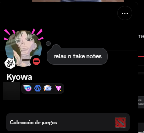

<div align="center">

# Badge Larper

**Customize Discord profile badges with Vencord.**

Client-side only · Visual changes · No real badges or permissions granted



### Supported Clients

<a href="https://vencord.dev"></a>
</div>

## Features

- Add and remove custom badges on user profiles.
- Hide existing badges locally and restore them.
- Select individual badges in the **Manage Badges** context menu.
- Use **Give All Badges**, **Remove All Badges**, or **Reset to Original**.
- Save individual preferences locally through Vencord's DataStore.

## Installation — Windows

Use PowerShell and run the steps in order. If a command fails, stop before continuing.

### 1. Install the tools

Install [Git](https://git-scm.com/downloads/win), [Node.js LTS](https://nodejs.org/en/download), and [Discord Desktop](https://discord.com/download). Use a Node.js version supported by Vencord's `engines.node` field (22 or newer in the inspected checkout).

Open a new PowerShell window and set up [Corepack](https://github.com/nodejs/corepack) to provide pnpm:

```powershell
npm install --global corepack@latest
corepack enable pnpm
```

Corepack selects the pnpm version required by Vencord's `package.json` automatically. If you already use Corepack, you do not need to install it again. If an existing pnpm installation conflicts with setup, see Troubleshooting.

### 2. Download Vencord

Open PowerShell in the folder where you want to keep Vencord, then run:

```powershell
git clone https://github.com/Vendicated/Vencord.git
cd Vencord
```

Already have the source? Open PowerShell in your existing Vencord folder instead. Keep this window open there for the remaining commands.

### 3. Create the plugin folders

In **Windows File Explorer**:

1. Open your Vencord folder, then open `src`.
2. If `userplugins` is missing, create it. **This is normal.**
3. Inside `userplugins`, create a folder named `badgeSelector`.

The folder must be named `badgeSelector`, even though the plugin is called Badge Larper. No PowerShell folder commands are needed.

### 4. Add the plugin

Download `index.tsx` from this GitHub repository using **Raw → Download raw file**, or download and extract the repository ZIP. Place the file directly inside `badgeSelector` using File Explorer:

```text
Vencord/
└── src/
    └── userplugins/
        └── badgeSelector/
            └── index.tsx
```

Do not add an extra nested `Badge-Larper` folder. Make sure the filename is `index.tsx`, not `index.tsx.txt` or a saved HTML page. You can enable **View → Show → File name extensions** in File Explorer to check it.

### 5. Install dependencies and build

Back in PowerShell, inside your Vencord folder, run these commands one at a time:

```powershell
pnpm install --frozen-lockfile
pnpm build --dev
```

Wait for each command to finish successfully before continuing. These are supported by the inspected Vencord checkout; see the [official guide](https://docs.vencord.dev/installing/) if your checkout uses different scripts.

### 6. Install your custom build

Fully quit Discord, including its system-tray process. From the same Vencord folder, run:

```powershell
pnpm inject
```

Follow the installer prompts and select your Discord installation. This installs the custom build you just made.

### 7. Enable Badge Larper

Open Discord → **User Settings → Vencord → Plugins**, search for **Badge Larper**, and enable it. Then right-click a user and select **Manage Badges**.

## Troubleshooting

| Problem | Fix |
| --- | --- |
| `pnpm is not recognized` | Reopen PowerShell, return to the Vencord folder, and try `pnpm --version`. If it is still missing, repeat step 1 or check the [pnpm installation guide](https://pnpm.io/installation). |
| Corepack setup conflicts with an existing pnpm installation | Follow the [official Corepack setup instructions](https://github.com/nodejs/corepack#manual-installs) for existing global installations. Do not force-overwrite files or edit Vencord's required version to hide the mismatch. |
| Missing `userplugins` folder | This is expected in a fresh checkout. Create `src/userplugins/badgeSelector` manually in File Explorer, as shown in step 3. |
| Plugin does not appear in Discord | Check the exact file path and extension, rebuild, install from that same checkout, and restart the correct Discord channel. Search for **Badge Larper**. Keep only one copy of the plugin. |
| Build errors | Read the first error and confirm you have the latest plugin file and the pnpm version listed in Vencord's `packageManager` field. Source-code errors require a compatible plugin revision; do not install a failed build. |

**PowerShell blocks `npm.ps1` or `pnpm.ps1`?** Use the corresponding `.cmd` command instead. For example:

```powershell
npm.cmd install --global corepack@latest
corepack.cmd enable pnpm
pnpm.cmd install --frozen-lockfile
```

Use the same substitution for the build and injection commands if needed. You do not need to disable Windows security protections.

## Disclaimer

Badges are local visual changes, not badges granted by Discord. Other users cannot see them in their clients, although screenshots or streams can show your local display. Discord updates may break compatibility. Modified clients may violate [Discord's Terms of Service](https://discord.com/terms). Use at your own risk; this plugin is not endorsed by Discord or Vencord.
